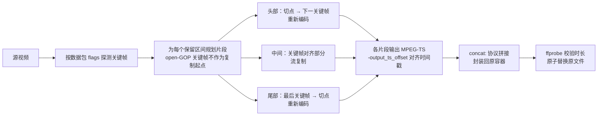

<div align="center">

# bili-sync-sponsorblock

**B 站 / YouTube 自动下载 + SponsorBlock 广告剪辑 + 核显智能精确裁剪，为 NAS 与 Emby / Jellyfin 而生**

[](./License)
[](https://github.com/pengyuw96/bili-sync-sponsorblock/commits/main)
[](https://github.com/NeeYoonc/bili-sync-up)
[](#-快速开始)
[](#-硬件与兼容性)
[](#-智能裁剪原理beta)

</div>

基于 [NeeYoonc/bili-sync-up](https://github.com/NeeYoonc/bili-sync-up)（上游 [amtoaer/bili-sync](https://github.com/amtoaer/bili-sync)）的社区 fork：在下载完成后按 [BilibiliSponsorBlock](https://github.com/hanydd/BilibiliSponsorBlock) 数据自动剪掉恰饭片段，并提供只重编码切点附近几秒、可调用 Intel 核显的 **智能精确裁剪（BETA）**。

> 当前版本 **v3.1.5.1**（Cargo 包版本 `3.1.5`，Cargo 不支持四段版本号），上游基线 bili-sync-up **v3.1.5**。非官方版本，问题请勿反馈到上游。本仓库不发布 Release / 镜像，需要自行编译。

## 📑 目录

- [✨ 功能亮点](#-功能亮点)
- [🧠 智能裁剪原理（BETA）](#-智能裁剪原理beta)
- [⚖️ Stable 与 Beta 对比](#️-stable-与-beta-对比)
- [🖥️ 硬件与兼容性](#️-硬件与兼容性)
- [🚀 快速开始](#-快速开始)
- [⚙️ 配置参考](#️-配置参考)
- [🔁 SponsorBlock 处理流程](#-sponsorblock-处理流程)
- [❓ 常见问题](#-常见问题)
- [🔀 与上游的区别](#-与上游的区别)
- [🗺️ 路线图与已知问题](#️-路线图与已知问题)
- [🙏 致谢与许可](#-致谢与许可)

## ✨ 功能亮点

- ✂️ **SponsorBlock 自动剪辑（B 站）**：下载合并后拉取 BilibiliSponsorBlock 片段，剪掉恰饭 / 垫片等类别，原子替换原文件；默认发布满 72 小时再下载。
- ▶️ **YouTube SponsorBlock**：下载完成后查询官方 `sponsor.ajay.app`（隐私 hash 前缀，与 B 站 `bsbsb.top` 完全分离）；默认硬剪 `sponsor` + `selfpromo`，`intro` / `outro` / `filler` 仅章节标记；默认发布满 24 小时再下载；裁剪复用现有智能裁剪管线。
- 🚫 **仅维护 B 站 + YouTube**：抖音 / TikTok 入口与扫描已停用（已下载文件保留，数据库迁移保留）。
- 🎛️ **按视频源单独开关**：每个收藏夹、合集、UP 主投稿、稍后再看都可以单独启用或关闭剪辑，新建视频源时即可设置。
- 🔑 **关键帧裁剪（stable，默认）**：纯流复制，不重新编码，画质无损、速度快，切点吸附到关键帧。
- 🎯 **智能精确裁剪（BETA）**：只重编码每个切点到相邻关键帧之间的几秒，其余部分流复制，切点精确到帧。
- ⚡ **核显硬件编码**：编码器按 `hevc_vaapi` → `hevc_qsv` → `libx265` 依次尝试，全部失败则自动回退 stable。
- 🎞️ **以 H.265 为主**：针对 B 站 HEVC 片源优化，也支持 H.264；open-GOP 关键帧（H.264 非 IDR / HEVC CRA）不会被当作流复制起点，出错自动回退。
- 🐢 **低 CPU 占用**：`nice 10`、`-threads 2`、同一时间只剪一个视频，不拖慢 NAS。
- 📝 **时间轴全对齐**：字幕、弹幕、章节与视频使用同一组实际删除区间；剪后用 ffprobe 实测时长修正章节、NFO `<runtime>` 和数据库时长。
- 👤 **非 root 运行**：入口脚本只用 root 给容器内的 `/dev/dri` 设备授权（宿主机设备权限不变），然后以 `PUID:PGID` 运行，下载的文件直接属于对应用户和用户组。
- 🗑️ **彻底删除视频**：网页删除视频时，连同该视频的整个文件夹（视频、NFO、图片、字幕、弹幕、SponsorBlock 计划等）一起删除，再向上清理变空的父目录，止于视频源根目录；路径不在视频源根目录内、或目录里还有其它视频时拒绝删除。
- ☑️ **批量选择「全选本页」**：视频列表批量模式下一键全选 / 取消当前页视频。
- 📁 **同名文件夹直接复用**：目标文件夹已存在时直接复用并覆盖，不再生成「-发布时间-BV号」后缀的重复目录。
- 📺 **Emby / Jellyfin 适配**：统一单 P 文件名、下载整轮结束后定向通知扫库、路径映射。

## 🧠 智能裁剪原理（BETA）

流复制只能从关键帧开始切，所以 stable 模式会把切点提前到上一个关键帧。智能裁剪的做法是：只把「切点 → 下一个关键帧」这一小段重新编码，中间整段 GOP 照常流复制，最后拼接起来。



编码器回退链：


- VAAPI 使用 `format=nv12,hwupload` 上传帧；重编码片段帧数按源帧率封顶，并以 `fps_mode passthrough` 保持原时间戳。
- 实测（作者 NAS，Intel N5095，HEVC 测试视频）：4 个视频中 3 个剪后时长误差在 **+0.011 s** 以内；VAAPI 比 libx265 快约 **30–50%**。

## ⚖️ Stable 与 Beta 对比

| | stable（默认） | beta_smart（BETA） |
|---|---|---|
| 切点精度 | 吸附到上一个关键帧，可能多留不到一个 GOP | 精确到帧 |
| 重新编码 | 无 | 仅切点附近几秒 |
| 画质 | 无损 | 绝大部分无损，重编码的几秒有轻微损失 |
| 速度 / CPU | 最快，几乎不占 CPU | 有核显时很轻；纯 CPU（libx265）较慢 |
| 依赖 | ffmpeg | ffmpeg；建议映射 `/dev/dri` |
| 失败处理 | `fail_open` 保留原片 | 自动回退 stable |

> `cut_mode = accurate` 是另一种老模式：整片用 libx264 重新编码，最精确但最耗 CPU，此时 `cut_strategy` 不生效。

## 🖥️ 硬件与兼容性

| 片源编码 | hevc_vaapi | hevc_qsv | libx265（CPU） | stable 回退 |
|---|---|---|---|---|
| H.265 / HEVC（主要测试） | ✅ 首选 | ✅ | ✅ | ✅ |
| H.264 / AVC | ⚠️ 支持，见已知问题 | ⚠️ | ⚠️ | ✅ |
| open-GOP 关键帧 | 跳过，改用下一个干净关键帧或重编码 | | | ✅ 出错时回退 |

- 已验证平台：Intel **N5095**（Jasper Lake），QNAP，Alpine 3.22 + ffmpeg 6.1.2 + `intel-media-driver` / `intel-media-sdk` / `onevpl-libs`。
- 其它较新的 Intel 核显理论可用但未测试；AMD / NVIDIA 硬件编码目前未接入，会回退到 libx265。
- 只构建 linux/amd64（静态 musl 二进制）。

## 🚀 快速开始

### 1. 编译

```sh
cd web && npm ci && npm run build && cd ..
cargo build --release --target x86_64-unknown-linux-musl -p bili_sync
tar czf bili-sync-rs-Linux-x86_64-musl.tar.gz -C target/x86_64-unknown-linux-musl/release bili-sync-rs
```

### 2. 构建镜像

把 tarball、`Dockerfile.qnap`（改名为 `Dockerfile`）和 `deploy/qnap-entrypoint.sh` 放在同一目录：

```sh
docker build -t bili-sync-sponsorblock:3.1.5.1 .
```

### 3. 运行（docker run）

```sh
docker run -d --name bili-sync-sponsorblock --restart unless-stopped \
  --user 0:0 --cap-drop ALL \
  --cap-add CHOWN --cap-add FOWNER --cap-add SETUID --cap-add SETGID \
  --security-opt no-new-privileges \
  --device /dev/dri/renderD128 \
  -e PUID=1000 -e PGID=1000 -e TZ=Asia/Shanghai \
  -p 12345:12345 \
  -v /path/to/config:/app/.config/bili-sync \
  -v /path/to/media/bili-sync:/bili-sync \
  bili-sync-sponsorblock:3.1.5.1
```

### 4. 运行（docker compose）

见 [`deploy/docker-compose.nas.yml`](deploy/docker-compose.nas.yml)：

```yaml
services:
  bili-sync-sponsorblock:
    image: bili-sync-sponsorblock:3.1.5.1
    container_name: bili-sync-sponsorblock
    restart: unless-stopped
    user: "0:0"            # 仅入口脚本用 root，程序本身以 PUID:PGID 运行
    cap_drop: [ALL]
    cap_add: [CHOWN, FOWNER, SETUID, SETGID]
    security_opt: [no-new-privileges]
    devices:
      - /dev/dri/renderD128:/dev/dri/renderD128   # 可选：核显智能裁剪
    environment:
      - PUID=1000
      - PGID=1000
      - TZ=Asia/Shanghai
    ports:
      - "12345:12345"
    volumes:
      - /path/to/config:/app/.config/bili-sync
      - /path/to/media/bili-sync:/bili-sync
```

- 媒体目录统一挂载到 `/bili-sync`，Web 界面里的路径都写 `/bili-sync/...`。
- 不映射 `/dev/dri` 也能运行，智能裁剪会用 libx265 或回退 stable。

### 威联通（QNAP）说明

- 宿主机 `/dev/dri/renderD128` 默认是 `600 admin:administrators`，**不需要改**。`--device` 会在容器里创建一份独立的设备节点，入口脚本只修改这份（`chgrp PGID` + `chmod 660`）。
- `PUID` / `PGID` 填 NAS 上媒体用户的 UID / GID（可在 SSH 里 `id 用户名` 查看），该用户需要对媒体目录和配置目录有读写权限。
- UID 重启和重装容器都不会变；只有删除重建用户后才需要改 `PUID` / `PGID` 并修正目录所有者。

## ⚙️ 配置参考

`sponsor_block` 配置段（Web 设置页均可修改）：

| 字段 | 默认值 | 说明 |
|---|---|---|
| `enabled` | `false` | 全局总开关 |
| `server_address` | `https://www.bsbsb.top` | 主 API 服务器 |
| `mirror_server_addresses` | `["https://www.bsbsb.xyz"]` | 镜像服务器 |
| `categories` | `["sponsor","padding"]` | 要剪掉的类别 |
| `mark_categories` | `[]` | 不剪、只写成章节标记的类别 |
| `cut_mode` | `keyframe` | `keyframe`（流复制）或 `accurate`（整片 libx264 重编码） |
| `cut_strategy` | `stable` | keyframe 模式下的策略：`stable` 或 `beta_smart`（界面「关键帧裁剪策略」，带 BETA 标记） |
| `min_segment_seconds` | — | 短于此值的片段忽略 |
| `min_keep_gap_seconds` | — | 短于此值的保留间隙并入删除区间 |
| `fail_open` | `true` | 出错时保留原片，只记日志 |
| `heartbeat_interval_secs` | `300` | 服务器心跳检测间隔，0 为关闭 |
| `download_delay_hours` | `72` | 新视频发布后延迟下载小时数（0 关闭），给片段提交留时间 |

`sponsor_block_youtube` 配置段（与 B 站完全分离，Web 设置页「SponsorBlock（YouTube）」）：

| 字段 | 默认值 | 说明 |
|---|---|---|
| `enabled` | `false` | YouTube 总开关 |
| `server_address` | `https://sponsor.ajay.app` | 官方 SponsorBlock API |
| `categories` | `["sponsor","selfpromo"]` | 硬剪类别 |
| `mark_categories` | `["intro","outro","filler"]` | 仅章节标记 |
| `cut_strategy` | `beta_smart` | 默认复用智能裁剪 |
| `download_delay_hours` | `24` | 新视频延迟下载（小时） |
| `fail_open` | `true` | 出错保留原片 |

**按视频源开关**：在每个视频源（收藏夹 / 合集 / 投稿 / 稍后再看）的设置里打开或关闭「SponsorBlock」，对应数据库字段 `sponsorblock_enabled`；全局 `enabled` 关闭时所有视频源都不剪。

环境变量：

| 变量 | 说明 |
|---|---|
| `PUID` / `PGID` | 程序运行的用户和组（容器以 root 启动时生效） |
| `BILI_SYNC_SMARTCUT_KEEP_TMP` | 设置后保留智能裁剪的临时片段，便于排查 |

```json
"sponsor_block": {
  "enabled": true,
  "categories": ["sponsor", "padding"],
  "mark_categories": [],
  "cut_mode": "keyframe",
  "cut_strategy": "beta_smart",
  "fail_open": true
}
```

## 🔁 SponsorBlock 处理流程

视频下载合并完成后，如果开启了 `sponsor_block.enabled`，会按下面的流程处理：

1. **获取片段（B 站）**：用 BV 号和 cid 请求 BilibiliSponsorBlock API `/api/skipSegments`，默认服务器是 `bsbsb.top`，失败时用镜像 `bsbsb.xyz`。只处理 `actionType = skip` 且类别在配置里的片段。
   - **YouTube**：下载完成后用 `sha256(videoID)` 前 4 位 hex 请求官方 `sponsor.ajay.app/api/skipSegments/{hash}?service=YouTube`，再按 videoID 过滤；失败可回退直查 `?videoID=`。配置键为 `sponsor_block_youtube`，不走 B 站服务器。
2. **计算保留区间**：合并重叠的删除区间，取反得到要保留的区间；太短的片段（`min_segment_seconds`）和太短的保留间隙（`min_keep_gap_seconds`）会被忽略或并入删除区间。
3. **ffmpeg 剪辑**，有两种模式：
   - `cut_mode = keyframe`（默认）：流复制，不重新编码，速度快、画质无损。每段保留区间的起点会**吸附到它之前最近的关键帧**，这与 ffmpeg 在 `-c copy` 下的实际行为一致。
   - `cut_mode = accurate`：用 libx264/aac 重新编码，切点精确到帧，但很耗 CPU。失败时会回退到 keyframe 模式。
   - 剪完后原子替换原文件，**不再保留未剪辑的原片**（旧版本的 `*.sb-orig` / `*.sponsor-original.*` 不再生成）。
4. **字幕和弹幕同步对齐**：字幕（srt/ass）和弹幕（ass）使用和视频**同一组吸附后的删除区间**来平移时间轴，所以音画、字幕、弹幕都在同一条时间线上。每个文件只平移一次。剪辑计划记录在隐藏文件 `.{文件名}.sponsorblock.json` 里，之后刷新弹幕或重写字幕时不会被重复平移。
5. **时长修正**：剪辑后用 ffprobe 测量实际时长，并据此更新章节结束时间、同名 NFO 的 `<runtime>` 和数据库里的分 P 时长。
6. **章节标记（可选）**：`mark_categories` 里的类别不剪辑，而是写成 MP4/MKV 章节（使用中文标题），同时在字幕和弹幕中插入 `〔SB〕` 提示，方便在 Emby/Jellyfin 里手动跳到下一章节。同一类别如果同时出现在剪辑和标记里，以剪辑为准。
7. **容错**：默认 `fail_open`，API 或 ffmpeg 出错时保留原下载文件，只记日志。视频源开启了「按章节拆分」时会跳过 SponsorBlock 处理。


### Emby / Jellyfin 适配

- **单 P 视频统一文件名**：视频、`-thumb`、`-fanart`、NFO、字幕、弹幕都用文件夹名作为文件名（和 3Blue1Brown 这类目录的结构一致），这样 Emby 能正确显示封面。同时修复了文件夹图片文件名为空的问题。
- **下载完成后通知扫库**（参考 MoviePilot / Sonarr 的实现）：
  - 一整轮下载（包括 SponsorBlock 剪辑）全部结束后，再等待 `delay_seconds`（默认 300 秒），然后**只通知一次**。如果等待期间又开始了新一轮，会继续顺延。
  - 优先定向扫描：`POST /Library/Media/Updated`；失败时可回退到全库扫描 `POST /Library/Refresh`（`fallback_full_refresh`）。
  - 支持路径映射，按最长前缀把容器内路径（如 `/bili-sync/...`）转换成媒体服务器看到的路径。套件版 Emby 填 NAS 上的真实路径即可。
  - API Key 只放在 `X-Emby-Token` 请求头里，不写入日志，接口也只返回「是否已设置」。


## ❓ 常见问题

<details>
<summary><b>CPU 占用很高，核显好像没用上？</b></summary>

1. 确认容器映射了 `--device /dev/dri/renderD128`。
2. 进容器执行 `vainfo`，应看到 iHD 驱动和 `VAProfileHEVCMain`。
3. 用程序的身份测试：`docker exec -u PUID:PGID 容器名 ffmpeg -f lavfi -i testsrc=d=1 -vaapi_device /dev/dri/renderD128 -vf format=nv12,hwupload -frames:v 1 -c:v hevc_vaapi -f null -`。
4. 日志里会写出智能裁剪实际使用的编码器；探测失败也会记录原因。注意即使用了核显，拼接、探测等步骤仍会占少量 CPU。
</details>

<details>
<summary><b>下载的文件属于 root / admin？</b></summary>

用 `--user 0:0` 加 `PUID` / `PGID` 启动（见快速开始），入口脚本会切换到该用户并设置 `umask 002`。旧版本留下的 root 文件需要手动 `chown` 一次。
</details>

<details>
<summary><b>剪完后时长和预期差一点 / 还残留约 1 秒广告？</b></summary>

stable 模式切点吸附到关键帧，B 站 GOP 一般 1 到数秒，可能多留不到一个 GOP，字幕弹幕按实际切点对齐不会错位。想要精确可开 `beta_smart`。少数奇数帧率的 HEVC 片源在 beta 模式下也可能有小幅时长漂移（见已知问题）。
</details>

<details>
<summary><b>open-GOP 片源会怎样？</b></summary>

如果关键帧不是 IDR（H.264 非 IDR 关键帧 / HEVC CRA），从它开始流复制、接在重编码片段之后，解码器可能乱序输出帧。所以智能裁剪不会把这类关键帧当作流复制起点，而是用下一个干净的关键帧，必要时整段重编码；如果仍然失败，就回退 stable。这是预期行为。
</details>

<details>
<summary><b>Emby 扫不到新视频？</b></summary>

检查路径映射：把容器内的 `/bili-sync/...` 映射成媒体服务器看到的路径；通知在一整轮下载结束后再等 `delay_seconds`（默认 300 秒）才发送。
</details>

## 🔀 与上游的区别

- 新增 SponsorBlock 剪辑（stable / beta_smart / accurate）、按视频源开关、章节标记、字幕弹幕时间轴对齐。
- 新增 Emby / Jellyfin 适配：统一单 P 文件名、整轮结束后定向通知扫库、路径映射。
- 镜像加入 Intel VAAPI / QSV 运行库和非 root 入口脚本。
- 视频处理并发默认 1（限制 1～2），避免 NAS 上 ffmpeg 抢资源。
- 仓库精简：去掉上游的 CI、文档站和截图，只保留源码；不发布 Release / 镜像。
- `deploy/` 下的辅助脚本默认只做演练：`cleanup-sb-orig.sh`（清理旧版未剪原片）、`migrate-episode-names.sh`（旧单 P 文件名迁移）。

## 🗺️ 路线图与已知问题

- ⚠️ **HEVC 奇数帧率漂移**：测试的 4 个 HEVC 视频里有 1 个（非整数帧率）剪后时长漂移超过 +0.011 s，仍在排查。
- ⚠️ **H.264 拼接问题**：H.264 片源的重编码片段与流复制部分拼接时仍有问题，H.264 建议暂时使用 stable。
- 🔜 视 beta 稳定性考虑将 `beta_smart` 转为默认。
- 🔜 AMD / NVIDIA 硬件编码暂未计划。

更详细的实现说明见 [`NOTES.md`](NOTES.md)，变更历史见 [`docs/changelog.md`](docs/changelog.md)。

## 🙏 致谢与许可

- [amtoaer/bili-sync](https://github.com/amtoaer/bili-sync)：原始项目
- [NeeYoonc/bili-sync-up](https://github.com/NeeYoonc/bili-sync-up)：本 fork 的直接上游
- [hanydd/BilibiliSponsorBlock](https://github.com/hanydd/BilibiliSponsorBlock)：片段数据、API，以及浏览器插件中精确剪切思路的参考
- [MoviePilot](https://github.com/jxxghp/MoviePilot)、[Sonarr](https://github.com/Sonarr/Sonarr)：媒体服务器通知的参考实现

以 [MIT](./License) 许可证发布。
